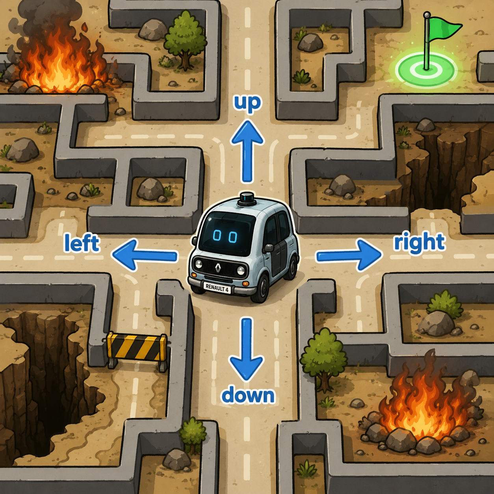
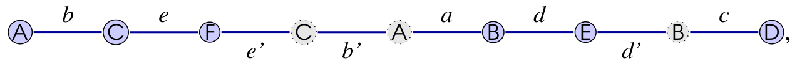

# 🧭 Simulador Visual de Algoritmos de Búsqueda en IA

Entorno interactivo desarrollado en **Python** y **Pygame** para visualizar, comparar y analizar el comportamiento de algoritmos de búsqueda informada y no informada sobre ambientes representados como laberintos con obstáculos y costos variables. Este entorno permite abstraer conceptos complejos tales como agente, espacio de estados, set de acciones, rutas óptimas, costo acumulado y número de nodos visitados, los cuales convencionalmente se describen mediante árboles de búsqueda o grafos. 

---

## 📑 Tabla de Contenidos
1. [Características Principales](#-características-principales)
2. [Instalación y Ejecución](#-instalación-y-ejecución)
3. [Fundamentos Teóricos de los Algoritmos](#-fundamentos-teóricos-de-los-algoritmos)
   - [Agente](#agente)
   - [Árbol de Búsqueda](#árbol-de-búsqueda)
   - [Depth First Search](#dfs-depth-first-search) 
   - [BFS-Breadth First Search](#breadth-first-search)
   - [UCS-Uniform Cost Search](#ucs-uniform-cost-search)
   - [GBFS-Greedy Best First Search](#gbfs)
   - [A*](#a*)
4. [Guía de Laboratorio: Experimentos Sugeridos](#-guía-de-laboratorio-experimentos-sugeridos)

---

## ✨ Características Principales
* **6 Estrategias de Búsqueda:** DFS, BFS, UCS, GBFS (Heurística Euclidiana), GBFS (Heurística Manhattan) y A*.
* **Dos Escenarios de Prueba:** Un laberinto simple para comprensión básica y un laberinto complejo con puentes, ríos de lava y abismos.
* **Manipulación del Entorno en Vivo:** Cambio dinámico del nodo inicial y edición personalizada de los costos de transición entre nodos.
* **Panel de Estadísticas:** Comparativa de nodos expandidos, costo total de la ruta y tiempo de ejecución[cite: 6, 13].

---

## 🚀 Instalación y Ejecución

### Requisitos previos
* Python 3.8 o superior.

### Pasos
1. Clona este repositorio:
   ```bash
   git clone [https://github.com/tu-usuario/tu-repositorio.git](https://github.com/tu-usuario/tu-repositorio.git)
   cd tu-repositorio

---
## 🧠 Fundamentos Teóricos de los Algoritmos
Los algoritmos de búsqueda son pilares fundamentales de la inteligencia artificial y han sido ampliamente utilizados para resolver problemas en los que a partir de un estado inicial se requiere llegar a un estado meta. Dentro de las aplicaciones de estos algoritmos se pueden encontrar soluciones para planificación de rutas y navegación geográfica (Google Maps), navegación en vehículos autónomos, pathfinding en video juegos, optimización de rutas en cadenas de suministro y enrutamiento de paquetes en redes de comunicaciones, entre muchas otras más. A continuación se describen los principales conceptos relacionados con los algoritmos de búsqueda informada y no informada, con el fin de dar soporte al simulador desarrollado. Para obtener información más detallada, se puede dirigir al libro del curso de introducción a la inteligencia artificial, disponible en: <a href="https://github.com/daalmart/IA-ML-Book/blob/main/ch01/ch01.pdf">Capítulo 1.</a>

---
### Agente
Un agente representa a una entidad con capacidad computacional que advierte los cambios en el ambiente mediante sensores y actúa de acuerdo con el conjunto de acciones disponible, hasta alcanzar el objetivo. Un agente puede representar a múltiples entidades dentro del contexto de la inteligencia artificial. Puede ser un vehículo autónomo, el cual puede decidir sobre sus acciones dependiendo de las variaciones del tráfico; un generador fotovoltaico o eólico que toma decisiones de acuerdo a los niveles de energía disponible en las baterías, la radiación solar o intensidad de los vientos y la demanda de energía; un vehículo aéreo no tripulado usado para agricultura de precisión en riego o fumigación de cultivos que decide sobre los niveles de agua o pesticida que debe aplicar dependiendo de la resequedad de la planta o nivel de plaga, respectivamente; un dron usado para actividades de búsqueda y rescate que identifica posibles víctimas a través de objetos tales como ropa, zapatos u otros elementos que sugieren la presencia de personas; un software de asistencia personal que agenda citas o automatiza actividades recurrentes.
Un agente opera dentro de un ambiente, y que ese ambiente posee múltiples estados que conforman lo que conocemos como espacio de estados. Dentro de cada estado, el agente puede tomar decisiones, es decir, ejecutar acciones que pertenecen al set de acciones. Esto se ilustra mejor en la Figura 1.

<p align="center">
  
  <br>
  <em>Figura 1: Un agente (vehículo) dentro de un ambiente con un espacio de estados y un set de acciones (arriba, abajo, derecha e izquierda). En este caso, el espacio de estados está dado por posiciones que el vehículo puede ocupar en su ruta desde el estado inicial hacia el el estado meta (bandera verde).</em>
</p>
Un agente puede calcular el conjunto de estados por los que debe pasar para llegar a la meta bajo diferentes condiciones que inluyen transiciones entre estados a través de acciones, costos de las acciones, valores de heurística y combinaciones de estos dos últimos parámetros. Para ello utiliza algoritmos de búsqueda informada y no informada. La búsqueda no informada involucra el conocimiento del estado inicial y el estado meta, junto con costos de las acciones. Dentro de estos algoritmos tenemos DFS (Depth First Search), BFS (Breadth First Search) y UCS (Uniform Cost Search) también denominado Dijkstra en honor al matemático y científico de la computación neerlandés Edsger W. Dijkstra. Por otra parte, los algoritmos de búsqueda informada usan valores de heurística para proporcionar cierta información sobre la ruta que el agente debe seguir con el fin de llegar a la meta con un costo menor. Dentro de este tipo de algoritmos tenemos GBFS (Greedy Best First Search) y A*, el primero basado completamente en heurísticas, y el segundo basado en la combinación de estos valores y el costo entre acciones. En el caso del simulador mostrado en esta sección, los valores de heurística siguen dos aproximaciones sobre los que el usuario puede escoger. La primera es una heurística Euclideana calculada desde cada estado hasta el estado meta usando la siguiente expresión:

$$h_{\text{euclidiana}}(n) = \sqrt{(x_1 - x_2)^2 + (y_1 - y_2)^2}.$$

La segunda se calcula también desde cada estado hasta el estado meta usando una distancia Mahnattan por medio de la siguiente expresión:

$$h_{\text{manhattan}}(n) = |x_1 - x_2| + |y_1 - y_2|,$$

donde $x_i$, $y_i$ representan las posiciones en el plano 2D para el agente mostrado en la Figura 1.

---
### Árbol de Búsqueda
Un árbol de búsqueda es un mecanismo gráfico que permite representar al espacio de estados mediante nodos (círculos) y las transiciones entre estos (enlaces entre nodos) que se producen por las acciones. En algunos casos, los enlaces entre nodos pueden incluir valores que reflejan los costos o recompensas por pasar de un estado a otro. En la Figura 2a, se muestra un ambiente en el que un agente tiene tres posibles rutas que parten de un estado inicial descrito por el círculo número uno. Cada círculo representa un estado del espacio de estados y puede interpretarse como una ubicación en un plano 2D con coordenadas (x,y). El agente puede moverse hacia los estados ejecutando las acciones representadas por las flechas. Es decir, tiene el siguiente set de acciones {adelante, atrás, izquierda y derecha}, pero algunas de estas no están disponibles en ciertos estados. La Figura 2b muestra la representación de este escenario a través de un árbol de búsqueda con un estado inicial o raíz dado por el círculo 1, un estado final o meta dado por el círculo 5, estados intermedios y acciones, las cuales son representadas como enlaces que conectan a los nodos para indicar las transiciones posibles entre estos. Algunos estados pueden aparecer más de una vez cuando hay varias transiciones que conducen a ellos, tal como ocurre con el estado meta y el estado 8. Es importante resaltar que generalmente en un árbol de búsqueda los enlaces no se simbolizan como flechas, lo cual indica que hay bi-direccionalidad entre estados. Esto significa que, dependiendo del problema, devolvernos de un estado X a un estado Y pueda requerir una acción no necesariamente contraria a la que produjo la transición entre Y y X.

<div align="center">
  <table>
    <tr>
      <td align="center">
        
        <br />
        <sub><b>a) Escenario real.</b> Un agente con tres rutas diferentes. Algunas lo pueden llevar hasta la meta pero otras pueden ser fatales. El agente puede moverse a través de las ubicaciones dentro del laberinto, las cuales están representadas por círculos numerados. En este caso, tales ubicaciones representan los estados. La dirección de las flechas indica la acción que el agente puede usar en cada estado.</sub>
      </td>
      <td align="center">
        
        <br />
        <sub><b>b) Árbol de búsqueda.</b> Algunos estados pueden aparecer más de una vez debido a que secuencias diferentes pueden conducir a ellos. En este caso tenemos dos rutas hacia el estado meta (Goal) y dos rutas diferentes para llegar al abismo con lava (estado 8).</sub>
      </td>
    </tr>
  </table>
  <p><em>Figura 2: Ejemplo de ambiente para un agente o vehículo autónomo (a), y su representación como un árbol de búsqueda (b).</em></p>
</div>

### Depth First Search
Es un algoritmo que hace una revisión de nodos hacia lo profundo de las ramas del árbol de búsqueda. Utiliza como mecanismo una pila tipo LIFO, en la cual inserta los nodos que se evalúan
para identificar si son o no el nodo meta. Adicionalmente, cada nodo que ingresa a la pila  se marca como visitado para evitar ciclos infinitos. Cuando el nodo evaluado no es el nodo meta, se insertan en la pila sus nodos hijos y se repite el proceso hasta llegar a la solución. Si un nodo no tiene hijos, y además no es el nodo meta, el algoritmo genera un proceso de retroceso (backtracking) para seguir la búsqueda en el siguiente nodo disponible. Para entender mejor este proceso, suponga el caso del árbol de decisión mostrado en la Figura 3. 

<p align="center">
  
   <br>
  <em>Figura 3: Árbol de búsqueda con nodo inicial A y nodo meta D. Las acciones están dadas por las letras en minúscula. Las acciones asociadas a backtracking se muestran como letras acompañadas de comilla simple (apóstrofo) y en color rojo.</em>
</p>

Los pasos a seguir por el algoritmo son los siguientes:

1. Se inserta el nodo inicial en la pila LIFO: [A].
2. Se extrae A de la pila y se marca como nodo visitado. Ya que el nodo A no es la meta, insertamos sus hijos en la pila y se marcan como visitados. La pila ahora es [B, C]. Es común que en las implementaciones en lenguajes de programación se denomine como pop y push a los procesos de extracción e inserción en la pila, respectivamente.
3. Si tenemos en cuenta que los nodos en la pila se van insertando de izquierda a derecha, entonces el nodo C es el último que entró. Por lo tanto, extraemos C. Ya que C no es el nodo meta, extraemos su único hijo que en este caso es F, lo ponemos en la pila y lo marcamos como visitado. La pila resultante es [B, F].
4. El siguiente nodo en ser extraído es el último en entrar (pila LIFO). Entonces extraemos F. Ya que no es el nodo meta, y no tiene hijos, se pasa a extraer el nodo B. Como se puede apreciar, en este paso hubo backtracking o retroceso, el cual no requirió manejo adicional debido a que está implícito en la forma en la que trabaja la pila LIFO.
5. Dado que el nodo B ya fue marcado como visitado, no se vuelve a insertar en la pila. El proceso de marcar a los nodos como visitados es muy importante cuando hay múltiples caminos al mismo nodo, esto evitará que el algoritmo se quede en un bucle infinito.
6. Se extrae el nodo B. Al no ser la meta, sus hijos, se marcan como visitados y se se extraen ponen en la pila, con lo cual se tiene [D, E].
7. E sale de la pila y se genera backtracking debido a que no tiene hijos y tampoco es la meta.
8. Solamente queda el nodo D. Dado que este es la meta, el algoritmo termina. La secuencia final de estados visitados es:

<p align="center">
  
</p>

y las acciones que el agente debe ejecutar son {b,e,e’,b’,a,d,d’,c}. Los nodos que se muestran en gris y con línea punteada, son aquellos que ya se habían marcado como visitados y no ingresan a la pila LIFO por segunda vez, esto, tal como ya lo hemos dicho, con el fin de evitar bucles infinitos en el algoritmo.
